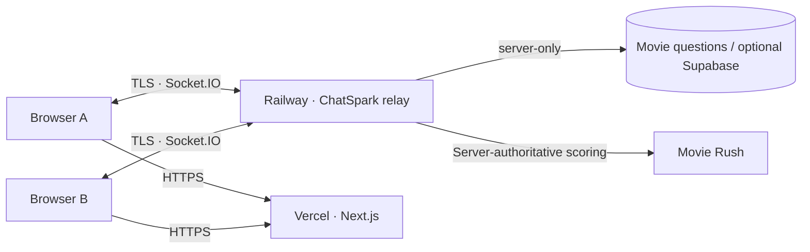

<div align="center">


# ✳ ChatSpark

### A Stranger Today. A Story Tomorrow.

**An animated, text-only stranger chat with real-time games, built for surprising conversations.**

[](https://nextjs.org/) [](https://nodejs.org/) [](https://socket.io/) [](#safety--privacy)

**[Website](https://chatspark-rc.vercel.app)** · **[Get started](#quick-start)** · **[How it works](#architecture)** · **[Privacy](#safety--privacy)**

</div>

---

## ✨ Meet someone new, without the noise

<table>
<tr>
<td width="50%"><b>💬 Real-time text matching</b><br/>Chat with a stranger; skip and match again. No video calls, camera, or microphone access.</td>
<td width="50%"><b>🎬 Movie Rush</b><br/>Two players, four identical movie clues, one first-to-guess winner. A 60-second round with server-side scoring.</td>
</tr>
<tr>
<td><b>🌐 Beautiful across devices</b><br/>Premium animated homepage, animated conversation preview, responsive layouts, multilingual pages.</td>
<td><b>🛡️ Privacy-minded design</b><br/>WebSocket messages are relayed by the server; strangers do not receive each other’s IP address or location.</td>
</tr>
<tr>
<td><b>🧠 Same Brain</b><br/>Quick, two-player icebreakers to turn awkward hellos into unexpected moments.</td>
<td><b>🎨 Sharing built in</b><br/>Celebrate a win with a shareable card that does not include private chat text or IP metadata.</td>
</tr>
</table>

## 🔮 A little look at the experience

<div align="center">
<table><tr><td align="center"><br/><sub>Dreamy globe aesthetic</sub></td><td align="center"><br/><sub>Rich gradients and fluid motion</sub></td></tr></table>
</div>

The live interface includes hover responses, floating light elements, animated messages, and a reduced-motion mode for accessibility. Images above are visual assets—not fake live-user counts or screenshots.

## 📁 Source layout

```text
ChatSpark/
├── web/                 # Next.js website, translations, UI, animation and art
│   ├── app/             # Localized pages and safety policies
│   ├── components/      # Chat UI, Movie Rush and animated homepage
│   ├── lib/             # Locale strings, metadata and UI helpers
│   └── public/art/      # Optimized, prebuilt visual assets
├── server/              # Socket.IO relay, matchmaking, game rules, moderation
│   ├── src/             # Event handlers and security rules
│   ├── data/            # Movie question bank and local SQLite database
│   └── test/            # Unit/integration tests
├── e2e/                 # Browser-level test scripts
├── scripts/             # Development proxy helpers
├── docs/                # Architecture and deployment guides
└── railway.json         # Railway build and runtime configuration
```

## ⚡ Quick start

Node.js **22.16+** is required; **24+** is recommended for the SQLite backend.

```bash
git clone https://github.com/vishsena864-collab/RC.git
cd RC

# In terminal 1
cd server
npm ci
cp .env.example .env
npm run dev

# In terminal 2
cd web
npm ci
cp .env.example .env.local
npm run dev
```

Open **http://localhost:3000**. For local use, set `NEXT_PUBLIC_SERVER_URL=http://localhost:4000` in `web/.env.local`. For production, configure the Railway HTTPS URL and matching CORS origins. **Never commit actual `.env` files or secrets.**

### Checks

```bash
cd server && npm test
cd ../web && npm run build
```

## 🏗️ Architecture



No WebRTC / STUN / peer-to-peer IP exchange is used in this text-only release. Additional design and runtime notes: [docs/ARCHITECTURE.md](docs/ARCHITECTURE.md).

## 🔐 Safety & privacy

- **No raw peer IPs exchanged:** server-mediated text chat; location, camera and microphone access are not needed.
- **No promise of total anonymity:** hosting companies, ISPs and security systems still process network metadata; recipients can copy shared text.
- **Report and skip:** moderation, rate limits, abuse-report retention rules, and matching cooldowns are built into the server.
- **18+ self-attestation isn't identity verification.** Adult content remains disabled until effective age assurance and moderation are added.
- **Secrets remain server-side:** configure the HMAC secret and server CORS origins through the host, not browser variables.
- **Trivia integrity:** answers are checked on the server. This public source repo includes a sample/editable question bank; do not assume the game is cheat-proof against someone reading the repo.

For a vulnerability or security report, see [SECURITY.md](SECURITY.md). For deployment caveats, see [docs/DEPLOYMENT.md](docs/DEPLOYMENT.md).

## 🎯 Movie Rush

- **345 famous movies**, each with four clues, packaged in `server/data/movie_questions.json` and the SQLite database.
- A challenge starts only after the other player accepts.
- The first valid, correct answer received by the server wins.
- **60-second countdown**, **12 guesses maximum per player**; no answer leaked to the browser before resolution.
- Winner cards omit personally identifying data.

## 🤝 Contributing

See [CONTRIBUTING.md](CONTRIBUTING.md) for local setup, testing and PR guidance.

---

<div align="center"><sub>Made for conversations, not surveillance · Built with care · ChatSpark ✳</sub></div>
